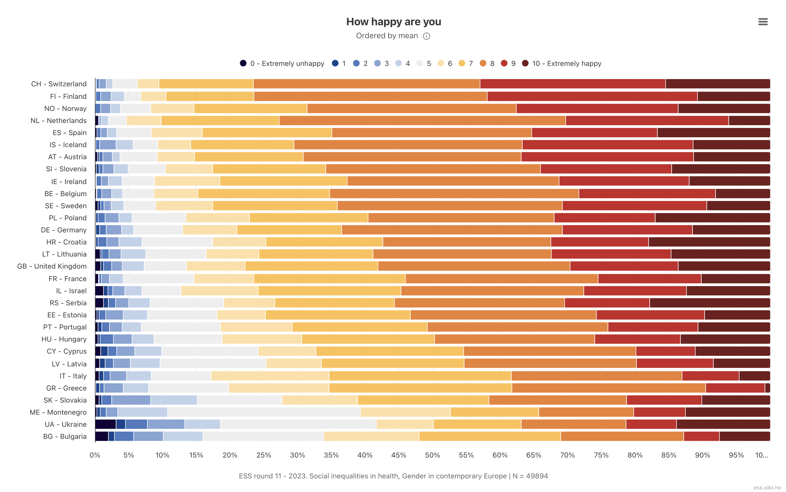
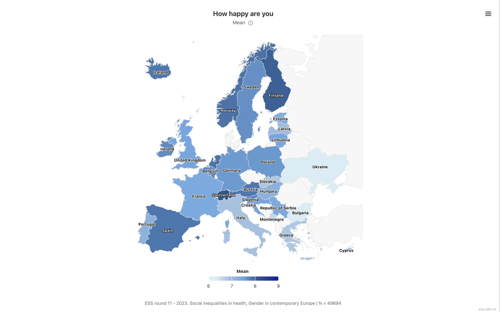

## Setup

Load the packages and read in the derived ESS data.

```{r}
#| label: setup
#| message: false
library(tidyverse)
library(srvyr)
library(sf)
library(tmap)

ess_der <- read_rds(here::here("DerivedData", "ess11_der.rds"))
```

## Our goal

By the end of these exercises, you will create two charts: a Likert-style stacked bar chart of the weighted distribution of happiness by country, and a map of weighted mean happiness by country.

[Variable explorer](https://ess.sikt.no/en/datafile/242aaa39-3bbb-40f5-98bf-bfb1ce53d8ef?tab=1&elems=391f8b4f-bda5-46f9-91e6-abf2fe4c2935){target="_blank"}

:::: {.columns}

::: {.column width="50%"}

:::

::: {.column width="50%"}

:::

::::

## Exercise 1: create the design object

Use `ess_der` and {srvyr} to create a survey design object called `ess_des`. The ESS design variables are:

- `psu`: primary sampling unit (cluster)
- `stratum`: stratum
- `anweight`: analysis weight

Remember that some `psu` codes repeat across different `stratum` values.

See the full methodology report: <https://www.europeansocialsurvey.org/methodology/sampling>

```{r}
#| label: ex1-design-object

```

## Exercise 2: estimate weighted mean happiness by country

- `Happy` is the ESS `happy` item (0 = extremely unhappy, 10 = extremely happy)
- Refusal/don't know/no answer codes already recoded to `NA`

Use `ess_des` to estimate weighted mean happiness by country. Save the result as `happy_by_country`.

```{r}
#| label: ex2-happy-by-country

```

## Exercise 3: calculate distribution of happiness level by country

Calculate the weighted count (`n`) and proportion (`p`) of each happiness level (0-10) within each country. Convert `Happy` to a factor with levels `0:10`, labeling 0 as "0 - Extremely unhappy" and 10 as "10 - Extremely happy". Keep both `cntry` and `Country` as grouping variables. Save the result as `happy_dist_country`.

Hint: use `interact(cntry, Country)` in `group_by()` so proportions are calculated within each country.

```{r}
#| label: ex3-happy-dist-country

```

## Exercise 4: identify the happiest and least happy countries

To keep the chart readable, identify the top and bottom 4 countries based on mean happiness (8 total, as in the reference chart). Save the country names as a character vector called `top_bottom_countries`.

```{r}
#| label: ex4-happy-top-bottom

```

## Exercise 5: make bar chart with country subset ordered by mean

A Likert-style stacked bar shows the full weighted distribution of raw 0-10 responses within each country. Using `happy_dist_country`, `happy_by_country`, and `top_bottom_countries`, create a stacked bar chart of the response distribution for the selected countries, ordered by mean happiness.

{fig-align="center"}

```{r}
#| label: ex5-happy-likert-plot

```

## Exercise 6: join country shapes to mean estimates

- Country is a natural domain for ESS analysis
- Choropleth maps make cross-country patterns easier to spot than a table

Get a base map from {tmap} using the object `World` and join the mean estimates from `happy_by_country` on. Crop the map to the extent of ESS using this code:

```r
dat_sf |>
  st_crop(
    st_bbox(c(xmin = -10, ymin = 32, xmax = 36, ymax = 70), crs = 4326) |>
      st_transform(3035)
  )
```

Save the result as `happy_shape`.

```{r}
#| label: ex6-happy-map-join

```

## Exercise 7: map colored by `Happy`

Using `happy_shape`, create a map with each country filled by its weighted mean happiness.

{fig-align="center"}

```{r}
#| label: ex7-happy-map-plot

```
