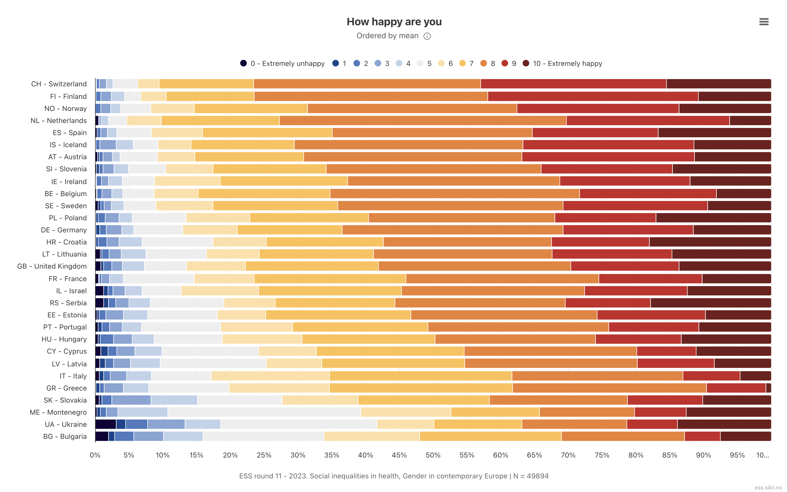
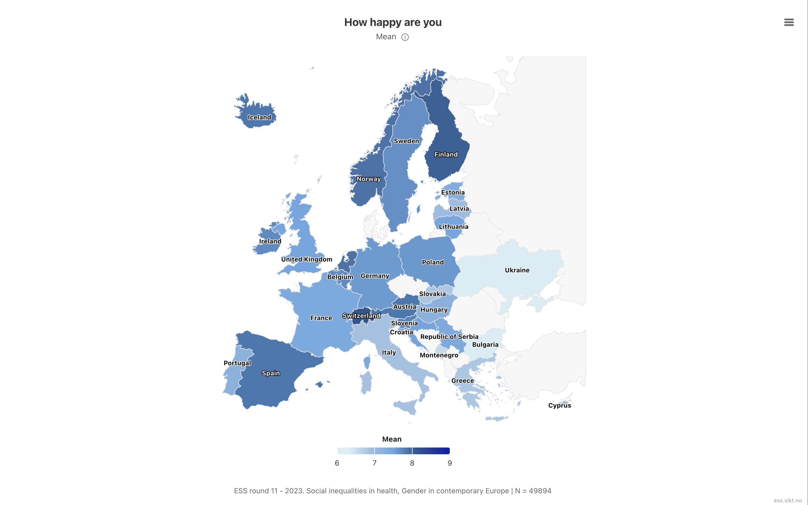

## Setup

Load the packages and read in the derived ESS data.

```{r}
#| label: setup
#| message: false
#| code-fold: false
library(tidyverse)
library(srvyr)
library(sf)
library(tmap)

ess_der <- read_rds(here::here("DerivedData", "ess11_der.rds"))
```

## Our goal

By the end of these exercises, you will create two charts: a Likert-style stacked bar chart of the weighted distribution of happiness by country, and a map of weighted mean happiness by country.

[Variable explorer](https://ess.sikt.no/en/datafile/242aaa39-3bbb-40f5-98bf-bfb1ce53d8ef?tab=1&elems=391f8b4f-bda5-46f9-91e6-abf2fe4c2935){target="_blank"}

:::: {.columns}

::: {.column width="50%"}

:::

::: {.column width="50%"}

:::

::::

## Exercise 1: create the design object

Use `ess_der` and {srvyr} to create a survey design object called `ess_des`. The ESS design variables are:

- `psu`: primary sampling unit (cluster)
- `stratum`: stratum
- `anweight`: analysis weight

Remember that some `psu` codes repeat across different `stratum` values.

```{r}
#| label: ex1-design-object
ess_des <- ess_der |>
  as_survey_design(
    ids = psu,
    strata = stratum,
    weights = anweight,
    nest = TRUE
  )

ess_des
```

- `nest = TRUE` tells {srvyr} that `psu` codes are only unique within `stratum`, so the same code in two strata is treated as two different clusters

## Exercise 2: estimate weighted mean happiness by country

- `Happy` is the ESS `happy` item (0 = extremely unhappy, 10 = extremely happy)
- Refusal/don't know/no answer codes already recoded to `NA`

Use `ess_des` to estimate weighted mean happiness by country. Save the result as `happy_by_country`.

```{r}
#| label: ex2-happy-by-country
happy_by_country <-
  ess_des |>
  filter(!is.na(Happy)) |>
  group_by(Country) |>
  summarize(Happy_mean = survey_mean(Happy, na.rm = TRUE))

happy_by_country
```

## Exercise 3: calculate distribution of happiness level by country

Calculate the weighted count (`n`) and proportion (`p`) of each happiness level (0-10) within each country. Convert `Happy` to a factor with levels `0:10`, labeling 0 as "0 - Extremely unhappy" and 10 as "10 - Extremely happy". Keep both `cntry` and `Country` as grouping variables. Save the result as `happy_dist_country`.

Hint: use `interact(cntry, Country)` in `group_by()` so proportions are calculated within each country.

```{r}
#| label: ex3-happy-dist-country
happy_dist_country <-
  ess_des |>
  filter(!is.na(Happy)) |>
  mutate(
    Happy_factor = factor(
      Happy,
      levels = 0:10,
      labels = c(
        "0 - Extremely unhappy", 1:9, "10 - Extremely happy"
      )
    )
  ) |>
  group_by(interact(cntry, Country), Happy_factor) |>
  summarize(
    n = survey_total(vartype = NULL),
    p = survey_mean(vartype = NULL)
  ) |>
  ungroup()

happy_dist_country
```

- `survey_total(vartype = NULL)` gives a weighted count per `Country` x `Happy_factor` cell without standard errors, which is all that's needed here since the plot shows a descriptive distribution, not an inferential estimate
- `interact(cntry, Country)` treats the two country variables as a single grouping variable, so `survey_mean()` returns proportions of `Happy_factor` within each country

## Exercise 4: identify the happiest and least happy countries

To keep the chart readable, identify the top and bottom 4 countries based on mean happiness (8 total, as in the reference chart). Save the country names as a character vector called `top_bottom_countries`.

```{r}
#| label: ex4-happy-top-bottom
n_countries <- 4

top_bottom_countries <-
  happy_by_country |>
  slice_max(Happy_mean, n = n_countries) |>
  bind_rows(
    happy_by_country |> slice_min(Happy_mean, n = n_countries)
  ) |>
  pull(Country)

top_bottom_countries
```

- `slice_max()`/`slice_min()` on `happy_by_country` pick the `n_countries` happiest and least happy countries; adjust `n_countries` to show more or fewer

## Exercise 5: make bar chart with country subset ordered by mean

A Likert-style stacked bar shows the full weighted distribution of raw 0-10 responses within each country. Using `happy_dist_country`, `happy_by_country`, and `top_bottom_countries`, create a stacked bar chart of the response distribution for the selected countries, ordered by mean happiness.

```{r}
#| label: ex5-happy-likert-plot
happy_likert <-
  happy_dist_country |>
  left_join(happy_by_country, by = "Country") |>
  filter(Country %in% top_bottom_countries) |>
  mutate(Label = fct_reorder(paste(cntry, "-", Country), Happy_mean))

ggplot(happy_likert, aes(y = Label, x = p, fill = Happy_factor)) +
  # reverse = TRUE keeps "0 - Extremely unhappy" on the left and
  # "10 - Extremely happy" on the right, matching the legend order
  geom_col(position = position_fill(reverse = TRUE)) +
  scale_fill_brewer(palette = "RdBu", direction = -1, name = NULL) +
  scale_x_continuous(labels = scales::percent) +
  labs(
    title = "How happy are you?",
    subtitle = glue::glue("Top and bottom {n_countries} countries by weighted mean"),
    x = NULL,
    y = NULL
  ) +
  theme_light() +
  theme(legend.position = "bottom")
```

- `fct_reorder()` sorts the remaining countries by `Happy_mean` so the happiest lands at the top of the plot, matching the ordering convention from the reference chart
- `scale_fill_brewer(palette = "RdBu", direction = -1)` gives a diverging blue-to-red palette across the 11 response categories
- `position_fill(reverse = TRUE)` is needed because `geom_col()`'s default stacking order would otherwise put "0 - Extremely unhappy" on the right

## Exercise 6: join country shapes to mean estimates

- Country is a natural domain for ESS analysis
- Choropleth maps make cross-country patterns easier to spot than a table

Get a base map from {tmap} using the object `World` and join the mean estimates from `happy_by_country` on. Crop the map to the extent of ESS using this code:

```r
dat_sf |>
  st_crop(
    st_bbox(c(xmin = -10, ymin = 32, xmax = 36, ymax = 70), crs = 4326) |>
      st_transform(3035)
  )
```

Save the result as `happy_shape`.

```{r}
#| label: ex6-happy-map-join
happy_shape <-
  World |>
  full_join(happy_by_country, by = c("name" = "Country")) |>
  st_transform(3035) |>
  st_crop(
    st_bbox(c(xmin = -10, ymin = 32, xmax = 36, ymax = 70), crs = 4326) |>
      st_transform(3035)
  )
```

## Exercise 7: map colored by `Happy`

Using `happy_shape`, create a map with each country filled by its weighted mean happiness.

```{r}
#| label: ex7-happy-map-plot
happy_shape |>
  ggplot() +
  geom_sf(aes(fill = Happy_mean), color = "darkgrey") +
  geom_sf_text(
    data = happy_shape |> filter(!is.na(Happy_mean)),
    aes(label = iso_a3),
    size = 3
  ) +
  scale_fill_distiller(
    palette = "Blues",
    direction = 1,
    na.value = "lightgrey",
    name = "Mean happiness\n(0-10 scale)"
  ) +
  labs(x = NULL, y = NULL) +
  theme_light()
```

- `geom_sf()` draws the polygons in the data's CRS (EPSG:3035 from Exercise 5) and adds lon/lat graticules automatically
- `scale_fill_distiller()` gives a continuous Brewer scale because `Happy_mean` is a continuous estimate, not a category; `direction = 1` makes higher happiness darker
- Countries without an ESS estimate have `NA` for `Happy_mean` after the `full_join`, so `na.value = "lightgrey"` shades them grey
- Only countries with an estimate are labelled, via `data = ... filter(!is.na(Happy_mean))` in `geom_sf_text()`
- Labels use `iso_a3` (from the `World` shapefile) rather than ESS's own 2-letter `cntry` codes, since the two don't share a common code column after the join
