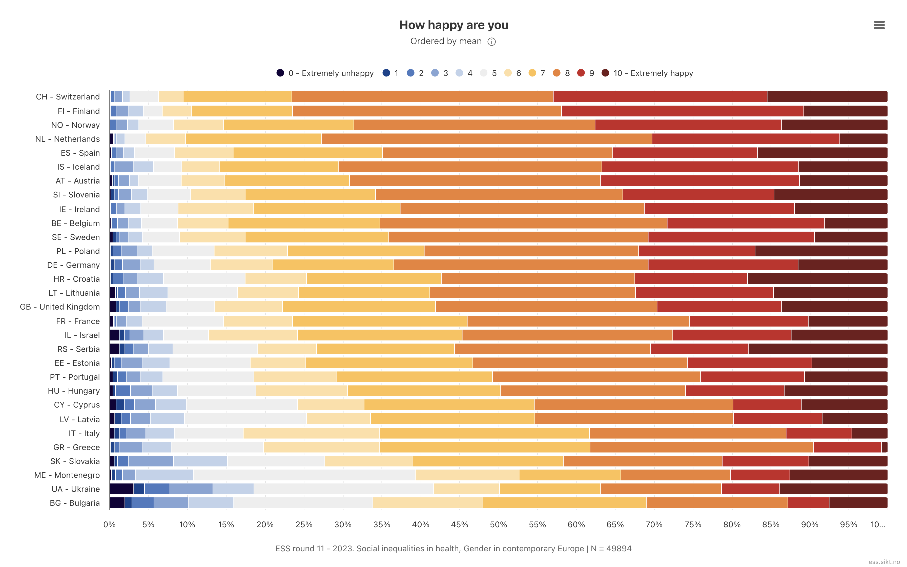
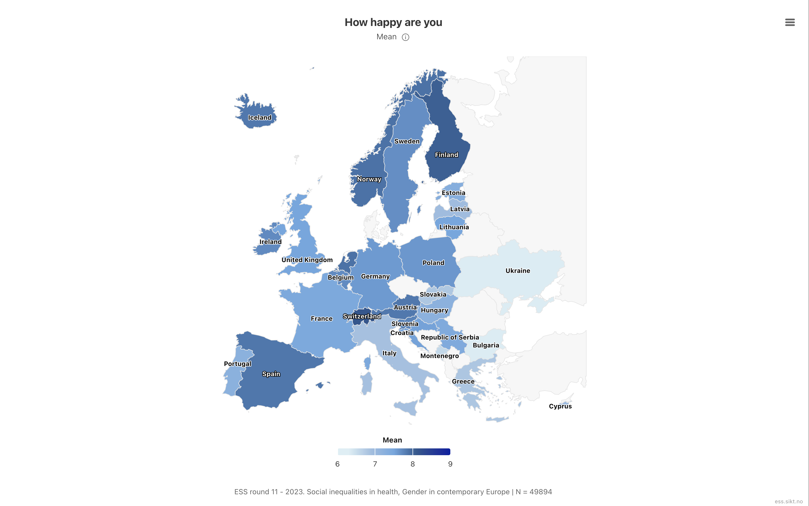

# Visualizing survey estimates   {background-color='' .bkg-buildings}

## Our goal

[Variable explorer](https://ess.sikt.no/en/datafile/242aaa39-3bbb-40f5-98bf-bfb1ce53d8ef?tab=1&elems=391f8b4f-bda5-46f9-91e6-abf2fe4c2935){target="_blank"}

:::: {.columns}

::: {.column width="50%"}

:::

::: {.column width="50%"}



:::

::::

## Exercise 1: estimate weighted mean happiness by country {.smaller}

- `Happy` is the ESS `happy` item (0 = extremely unhappy, 10 = extremely happy)
- Refusal/don't know/no answer codes already recoded to `NA`

Reuse `ess_des`, the design object built from `ess_der` in the ESS intro, to estimate weighted mean happiness by country.

```{r}
#| label: happy-by-country-exercise
#| output-location: slide
#| echo: false
happy_by_country <-
  ess_des |>
  filter(!is.na(Happy)) |>
  group_by(Country) |>
  summarize(Happy_mean = survey_mean(Happy, na.rm = TRUE))

happy_by_country
```



## Exercise 1: estimate weighted mean happiness by country

```{r}
#| label: happy-by-country-solution
#| output-location: slide
happy_by_country <-
  ess_des |>
  filter(!is.na(Happy)) |>
  group_by(Country) |>
  summarize(Happy_mean = survey_mean(Happy, na.rm = TRUE))

happy_by_country
```



## Likert chart: weighted response distribution by country

A map only shows the mean. A Likert-style stacked bar shows the full weighted distribution of raw 0–10 responses within each country.

{fig-align="center"}

## Exercise 2: Normalize data

```{r}
#| label: happy-dist-country-exercise
#| output-location: slide
#| echo: false
happy_dist_country <-
  ess_des |>
  filter(!is.na(Happy)) |>
  mutate(
    Happy_factor = factor(
      Happy,
      levels = 0:10,
      labels = c(
        "0 - Extremely unhappy", 1:9, "10 - Extremely happy"
      )
    )
  ) |>
  group_by(cntry, Country, Happy_factor) |>
  summarize(n = survey_total(vartype = NULL)) |>
  # Normalize within country so each country's bar sums to 100%
  mutate(p = n / sum(n)) |>
  ungroup()

happy_dist_country
```



## Exercise 2: Normalize data

```{r}
#| label: happy-dist-country-solution
#| output-location: slide
happy_dist_country <-
  ess_des |>
  filter(!is.na(Happy)) |>
  mutate(
    Happy_factor = factor(
      Happy,
      levels = 0:10,
      labels = c(
        "0 - Extremely unhappy", 1:9, "10 - Extremely happy"
      )
    )
  ) |>
  group_by(cntry, Country, Happy_factor) |>
  summarize(n = survey_total(vartype = NULL)) |>
  # Normalize within country so each country's bar sums to 100%
  mutate(p = n / sum(n)) |>
  ungroup()

happy_dist_country
```

## Exercise 3: keep only the happiest and least happy countries

To keep the chart readable, show only the `n_countries` countries with the highest and lowest weighted mean happiness (8 total, as in the reference chart).

```{r}
#| label: happy-top-bottom-exercise
#| echo: false
n_countries <- 4

top_bottom_countries <-
  happy_by_country |>
  slice_max(Happy_mean, n = n_countries) |>
  bind_rows(
    happy_by_country |> slice_min(Happy_mean, n = n_countries)
  ) |>
  pull(Country)
```



## Exercise 3: keep only the happiest and least happy countries

```{r}
#| label: happy-top-bottom-solution
n_countries <- 4

top_bottom_countries <-
  happy_by_country |>
  slice_max(Happy_mean, n = n_countries) |>
  bind_rows(
    happy_by_country |> slice_min(Happy_mean, n = n_countries)
  ) |>
  pull(Country)
```

## Exercise 4: order countries by mean and plot

```{r}
#| label: happy-likert-plot-exercise
#| output-location: slide
#| echo: false
happy_likert <-
  happy_dist_country |>
  left_join(happy_by_country, by = "Country") |>
  filter(Country %in% top_bottom_countries) |>
  mutate(Label = fct_reorder(paste(cntry, "-", Country), Happy_mean))

ggplot(happy_likert, aes(y = Label, x = p, fill = Happy_factor)) +
  # reverse = TRUE keeps "0 - Extremely unhappy" on the left and
  # "10 - Extremely happy" on the right, matching the legend order
  geom_col(position = position_fill(reverse = TRUE)) +
  scale_fill_brewer(palette = "RdBu", direction = -1, name = NULL) +
  scale_x_continuous(labels = scales::percent) +
  labs(
    title = "How happy are you?",
    subtitle = glue::glue("Top and bottom {n_countries} countries by weighted mean"),
    x = NULL,
    y = NULL
  ) +
  theme_light() +
  theme(legend.position = "bottom")
```

::: {.notes}
- `survey_total(vartype = NULL)` gives a weighted count per `Country` x `Happy_factor` cell without standard errors, which is all that's needed here since the plot shows a descriptive distribution, not an inferential estimate
- Dividing by `sum(n)` within each country (via `group_by(cntry, Country, Happy_factor)` peeling the last group in `summarize()`) turns weighted counts into within-country proportions
- `slice_max()`/`slice_min()` on `happy_by_country` pick the `n_countries` happiest and least happy countries; adjust `n_countries` to show more or fewer
- `fct_reorder()` sorts the remaining countries by `Happy_mean` so the happiest lands at the top of the plot, matching the ordering convention from the reference chart
- `scale_fill_brewer(palette = "RdBu", direction = -1)` gives a diverging blue-to-red palette across the 11 response categories
- `position_fill(reverse = TRUE)` is needed because `geom_col()`'s default stacking order would otherwise put "0 - Extremely unhappy" on the right
:::

## Exercise 4: order countries by mean and plot

```{r}
#| label: happy-likert-plot-solution
#| output-location: slide
happy_likert <-
  happy_dist_country |>
  left_join(happy_by_country, by = "Country") |>
  filter(Country %in% top_bottom_countries) |>
  mutate(Label = fct_reorder(paste(cntry, "-", Country), Happy_mean))

ggplot(happy_likert, aes(y = Label, x = p, fill = Happy_factor)) +
  # reverse = TRUE keeps "0 - Extremely unhappy" on the left and
  # "10 - Extremely happy" on the right, matching the legend order
  geom_col(position = position_fill(reverse = TRUE)) +
  scale_fill_brewer(palette = "RdBu", direction = -1, name = NULL) +
  scale_x_continuous(labels = scales::percent) +
  labs(
    title = "How happy are you?",
    subtitle = glue::glue("Top and bottom {n_countries} countries by weighted mean"),
    x = NULL,
    y = NULL
  ) +
  theme_light() +
  theme(legend.position = "bottom")
```

## Map survey estimates

- Country is a natural domain for ESS analysis
- Choropleth maps make cross-country patterns easier to spot than a table
- Builds on two earlier pieces: survey-weighted estimation (`srvyr`) + country shapes (`tmap`/`sf`)

{fig-align="center"}

## Exercise 1: join estimates to country shapes

Join on country name, then transform/crop to the same European extent used earlier.

```{r}
#| label: happy-map-join-exercise
#| echo: false
happy_shape <-
  World |>
  full_join(happy_by_country, by = c("name" = "Country")) |>
  st_transform(3035) |>
  st_crop(
    st_bbox(c(xmin = -10, ymin = 32, xmax = 36, ymax = 70), crs = 4326) |>
      st_transform(3035)
  )
```



## Exercise 1: join estimates to country shapes

```{r}
#| label: happy-map-join-solution
happy_shape <-
  World |>
  full_join(happy_by_country, by = c("name" = "Country")) |>
  st_transform(3035) |>
  st_crop(
    st_bbox(c(xmin = -10, ymin = 32, xmax = 36, ymax = 70), crs = 4326) |>
      st_transform(3035)
  )
```

## Exercise 2: map colored by `Happy`

```{r}
#| label: happy-map-plot-exercise
#| output-location: slide
#| echo: false
happy_shape |>
  tm_shape() +
  tm_polygons(fill = "lightgrey", col = "darkgrey") +
  tm_shape(happy_shape |> filter(!is.na(Happy_mean))) +
  tm_polygons(
    fill = "Happy_mean",
    fill.scale = tm_scale_continuous(values = "brewer.blues"),
    fill.legend = tm_legend(title = "Mean happiness\n(0-10 scale)")
  ) +
  tm_text("iso_a3") +
  tm_graticules()
```



::: {.notes}
- `tm_scale_continuous()` is used here (vs. `tm_scale_categorical()` in the earlier ESS-11 map) because `Happy_mean` is a continuous estimate, not a category
- Countries without an ESS estimate stay `lightgrey` because of the `full_join` + `filter(!is.na(Happy_mean))` pattern
- Labels use `iso_a3` (from the `World` shapefile) rather than ESS's own 2-letter `cntry` codes, since the two don't share a common code column after the join
- `ess_des` (built from `ess_der` in the ESS intro) is reused here
:::

## Exercise 2: map colored by `Happy`

```{r}
#| label: happy-map-plot-solution
#| output-location: slide
happy_shape |>
  tm_shape() +
  tm_polygons(fill = "lightgrey", col = "darkgrey") +
  tm_shape(happy_shape |> filter(!is.na(Happy_mean))) +
  tm_polygons(
    fill = "Happy_mean",
    fill.scale = tm_scale_continuous(values = "brewer.blues"),
    fill.legend = tm_legend(title = "Mean happiness\n(0-10 scale)")
  ) +
  tm_text("iso_a3") +
  tm_graticules()
```

::: {.notes}
- `tm_scale_continuous()` is used here (vs. `tm_scale_categorical()` in the earlier ESS-11 map) because `Happy_mean` is a continuous estimate, not a category
- Countries without an ESS estimate stay `lightgrey` because of the `full_join` + `filter(!is.na(Happy_mean))` pattern
- Labels use `iso_a3` (from the `World` shapefile) rather than ESS's own 2-letter `cntry` codes, since the two don't share a common code column after the join
- `ess_des` (built from `ess_der` in the ESS intro) is reused here
:::